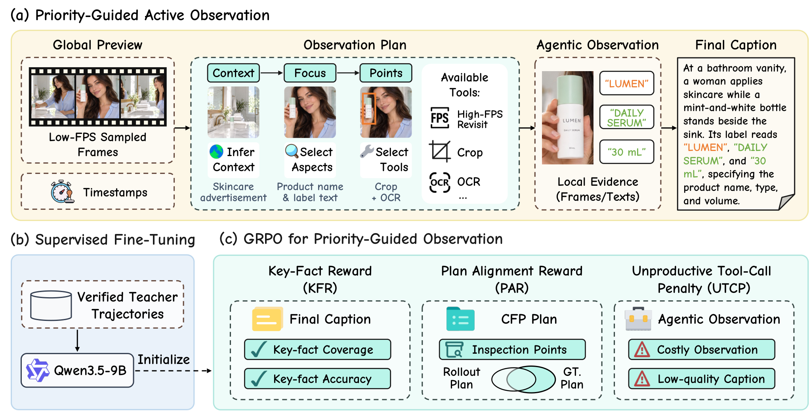

# Reviso: Not All Visual Evidence Deserves Equal Attention in Video Captioning

<p align="center">
  <a href="#overview">Overview</a> |
  <a href="#installation">Installation</a> |
  <a href="#inference">Inference</a> |
  <a href="#sft-training">SFT</a> |
  <a href="#grpo-training">GRPO</a> |
  <a href="https://huggingface.co/TengfeiLiuCoder/Reviso">Checkpoint</a>
</p>

Reviso describes videos through an iterative observation and reasoning loop built on **Qwen3.5 9B**. It identifies what needs further inspection, requests observations through caller-provided tools, and combines the collected evidence into a final caption.

<p align="center">
  
</p>

This repository contains the core LoRA supervised fine-tuning (SFT) implementation, group-based reward calculation, GRPO, and agentic inference controller. 
<a id="overview"></a>
## 🔍 Overview

Agentic video captioning requires a model to decide what to inspect as well as what to describe.

The core implementation covers three parts:

- **SFT:** learn assistant responses and tool requests with token-level supervision and language-side LoRA.
- **GRPO rewards:** combine caption fact matching, initial-plan matching, and an observation-cost penalty gated by group quality.
- **Inference:** Obtained the final caption through Agentic reasoning

<p align="center">
  
</p>

### Contents

1. [Installation](#installation)
2. [Inference](#inference)
3. [SFT Training](#sft-training)
4. [GRPO Training](#grpo-training)
5. [Citation](#citation)
6. [License](#license)

<a id="installation"></a>
## ⚙️ Installation

Use Python 3.12 and a CUDA-compatible PyTorch installation. From the repository root, install the SFT and inference dependencies:

```bash
python -m pip install -r requirements.txt
```

Set `PYTHON_BIN` to select the Python executable used by the shell scripts. Runtime caches default to `~/.cache/reviso`; set `REVISO_CACHE_DIR` to choose another location. Keep output paths separate from model, adapter, and input paths.

GRPO requires a separately installed training framework and a caller-supplied runner. The intended integration target is **veRL 0.9.1**. The dependency list is provided in [requirements.txt](requirements.txt).

The examples below use local paths and extension callables in `python_module:callable` form. Replace `your_package:...` with an implementation importable in the selected Python environment.

<a id="inference"></a>
## 🚀 Inference


```bash
bash scripts/infer.sh \
  --config configs/inference.yaml \
  --model-path /path/to/qwen3.5-model \
  --adapter-path /path/to/lora-adapter \
  --input /path/to/input \
  --backend your_package:build_backend \
  --output-file outputs/prediction.json
```

Omit `--adapter-path` to use the base model. The backend supplies the initial observation, tool schemas, conversation encoding, and tool execution. Configure generation settings and the turn limit in [configs/inference.yaml](configs/inference.yaml).

The controller waits for each tool result before continuing. The prompt uses a Context–Focus–Points (CFP) plan and readable sections. A final response places its observations and plan updates before `final_caption: ...` and ends with a standalone `action: STOP` line. JSON-only final responses with `final_caption` and `action="STOP"` remain supported. The saved JSON contains `caption`, `assistant_turns`, `tool_calls`, `extra_tool_calls`, and `tool_errors`; choose a new output path for each run, as existing files are preserved.

<details>
<summary>Observation backend and inference protocol</summary>

The backend factory receives `config` as a keyword argument and returns an object with four methods:

| Method | Responsibility |
| --- | --- |
| `tool_specs()` | Return schemas for the tools implemented by the backend. |
| `initial_content(source)` | Prepare the initial user observation from the input. |
| `encode(messages=..., tools=..., processor=...)` | Serialize the complete history into model-ready tensors. |
| `execute(name=..., arguments=...)` | Return an observation, raise `RecoverableToolError` for a request the model can revise, or propagate an infrastructure exception. |


Raise `inference.tool_interface.RecoverableToolError` with a model-readable message when an observation request can be revised. The controller returns this error, or an empty-result error, in the tool history so the model can update its plan. Failed invocations still count toward `extra_tool_calls`; the shared preview does not. Other exceptions propagate to the caller. The last response turn is reserved for a final caption, with no further tool execution. Unknown tools, malformed output, and context exhaustion still raise errors, and conversation history is retained without silent truncation. Recording tool observations and media alongside the output JSON is the caller's responsibility. A returned caption is not automatically a verified SFT trajectory.

</details>

<a id="sft-training"></a>
## 🔧 SFT Training

Provide a dataset factory that returns encoded Qwen3.5 inputs with assistant-token masks, then launch LoRA SFT:

```bash
bash scripts/train_sft.sh \
  --config configs/sft.yaml \
  --model-path /path/to/qwen3.5-model \
  --data-factory your_package:build_dataset \
  --output-dir outputs/sft
```

SFT updates language-side LoRA projections while freezing the visual tower and base weights. The objective averages each sequence's supervised assistant-token loss, giving sequences equal weight. One sequence is processed per device; gradient accumulation and distribution are handled by the installed Transformers Trainer.

Adjust LoRA and Trainer settings in [configs/sft.yaml](configs/sft.yaml). The adapter is saved to `outputs/sft/adapter`. Use `--resume /path/to/checkpoint` to restore a framework training checkpoint; `--adapter-path` loads adapter weights only.


<a id="grpo-training"></a>
## 🧩 GRPO Training

The reward combines three terms:

- **Key-Fact Reward (KFR):** fact F1 from maximum one-to-one matching of generated and reference atoms.
- **Plan Alignment Reward (PAR):** plan F1 from the same matching procedure applied to the initial plan.
- **Unproductive Tool-Call Penalty (UTCP):** the number of tool calls after the shared global preview, normalized by a fixed call budget and scaled by caption error. The penalty is enabled when a valid group member reaches the quality threshold.


```bash
bash scripts/train_grpo.sh \
  --config configs/grpo.yaml \
  --model-path /path/to/qwen3.5-model \
  --runner your_package:train_grpo \
  --output-dir outputs/grpo
```

This entry connects the local reward hooks to an external GRPO trainer. The runner owns model loading, rollout generation, tool execution, optimization, distribution, and checkpoints. Reward arithmetic and the judge protocol are defined in [training/reward.py](training/reward.py) and [training/reward_interface.py](training/reward_interface.py).


<a id="citation"></a>
## 🖊️ Citation

If you find Reviso useful, please cite:

```bibtex
@misc{liu2026revisovisualevidencedeserves,
      title={Reviso: Not All Visual Evidence Deserves Equal Attention in Video Captioning},
      author={Tengfei Liu and Yang Shi and Yuran Wang and Yuqi Tang and Yizhuo Jia and Zhuoran Zhang and Qixun Wang and Shujie Li and Xuanyu Zhu and Xinyu Liu and Minghui Guo and Shixuan Liu and Haotian Wang and Yuanxing Zhang and Pengfei Wan},
      year={2026},
      eprint={2611.03602},
      archivePrefix={arXiv},
      primaryClass={cs.CV},
      url={https://arxiv.org/abs/2611.03602},
}
```

<a id="license"></a>
## 📄 License

This project is licensed under the [Apache License 2.0](LICENSE).
